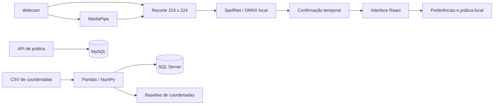

# Arquitetura

## Fluxo de reconhecimento

O SpellNet classifica imagens. O baseline de coordenadas é um pipeline independente, sem ligação automática com a câmera.

## Dependências do frontend

| Camada         | Dependências permitidas                                             |
| -------------- | ------------------------------------------------------------------- |
| domain         | Próprio domínio e recursos nativos da linguagem                     |
| application    | Domínio, outros casos de uso e React para os hooks                  |
| infrastructure | Contratos de domínio, APIs do navegador e bibliotecas de integração |
| presentation   | Domínio, aplicação e componentes visuais                            |
| bootstrap      | Implementações necessárias à composição                             |

main.tsx injeta AppServices na apresentação. bootstrap/services.ts é o ponto de criação de webcam, detector, classificador, armazenamento e exportação de texto. Nenhum hook da aplicação importa um adaptador concreto.

scripts/check_architecture.mjs verifica imports entre as camadas. Os caminhos dos arquivos WASM do fornecedor ficam na configuração do Vite, fora das regras do aplicativo.

## Apresentação

App organiza o layout e seleciona páginas. useWorkspace compõe navegação e os estados usados pelas telas. Câmera, prática e tradução têm hooks próprios; atalhos de teclado pertencem à apresentação.

Os componentes recebem somente os campos que declaram em suas propriedades. CameraCard reúne visualização, estado e controles; LandmarkOverlay, CameraPlaceholder e DemoPreview tratam seus próprios elementos. TranslationPanel e PracticePanel são independentes.

Os estilos são divididos em fundamentos, shell, câmera, tradução, aprendizado, páginas, sobreposições e responsividade. styles.css mantém a ordem dos imports para preservar a cascata.

## Contratos

- CameraPort: abrir e encerrar captura.
- HandDetectorPort: detectar pontos e liberar o detector.
- FrameClassifierPort: classificar um frame com a região da mão.
- ClassifierPort: classificar coordenadas normalizadas.
- StoragePort: ler e escrever preferências.
- TextPort: copiar e exportar texto.

RecognitionGate centraliza a política temporal. RECOGNITION_POLICY define score mínimo, duração, contagem e intervalo entre inferências. O score softmax não é uma medida calibrada de precisão.

## Serviços Python

Cada serviço segue a mesma divisão:

- api.py: fábrica FastAPI, validação HTTP e tradução de erros.
- application.py: casos de uso e contratos de repositório.
- domain.py ou contracts.py: entidades, resultados e protocolos.
- repository.py: consultas e transações SQL.
- database.py: configuração da conexão.
- main.py: montagem dos componentes.

PracticeService depende de PracticeRepository. TrainingService depende de ExperimentRepository. Os adaptadores SQL convertem falhas do driver em RepositoryUnavailable; os controladores não conhecem SQLAlchemy.

Prática possui MySQL; treinamento possui SQL Server. Não há consultas cruzadas ou sincronização obrigatória entre bancos. HTTP usa contratos /v1. As APIs não são chamadas pelo frontend nesta versão.

## Dados e ciclo de vida

Vídeo e recortes permanecem no dispositivo. Os modelos são baixados no primeiro uso. localStorage contém preferências e contagens manuais.

Cancelar uma solicitação invalida a captura pendente. Desligar a câmera encerra as tracks. A inferência é serializada e a sessão aguarda o trabalho pendente antes de liberar recursos. Perda da mão ou falha do detector apaga a previsão.

A normalização de coordenadas usa o punho como origem e a maior distância 3D como escala. A regra remove translação e escala uniforme; preserva orientação e lateralidade.

## Execução

O frontend é estático. As APIs e os bancos são executados separadamente pelo Docker Compose. Os testes HTTP usam repositórios substituíveis; conexão real, backups, autenticação e implantação dos bancos são verificações operacionais independentes.
